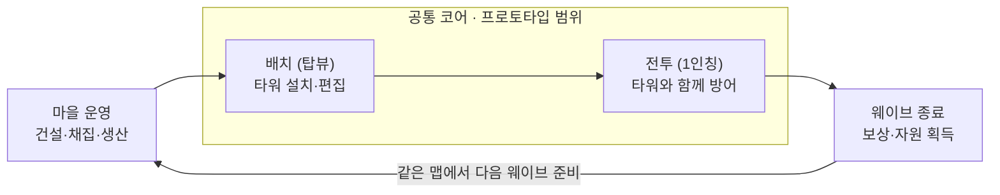

# 3D 타워 디펜스 — 게임 기획서

> 이 파일은 온라인 기획서(비공개)의 사본입니다. **원본은 온라인 문서**이며, 수정은 그쪽에서 하고 이 파일은 동기화로만 갱신합니다.
>
> 마지막 동기화: 2026-11-27

## 1. 개요

탑뷰로 방어선을 설계하고, 1인칭으로 직접 전장에 뛰어들어 타워와 함께 싸우는 하이브리드 타워 디펜스. 현재 목표는 핵심 재미를 검증할 프로토타입이다.

| 항목 | 내용 |
| --- | --- |
| 장르 | 타워 디펜스 + 1인칭 액션 |
| 엔진 | Unity 6.4 (6000.4.4f1), URP |
| 입력 | Input System |
| 플랫폼 | PC |
| 현재 단계 | 프로토타입 |
| 저장소 | [3D-Tower-Defense-Demo](https://github.com/Chosangyeol/3D-Tower-Defense-Demo) |

기존 타워 디펜스는 타워를 배치한 뒤 지켜보는 장르다. 이 게임은 배치가 끝나면 플레이어가 전장에 들어가 직접 전투에 참여하는 것이 차별점이다.

## 2. 게임 루프

게임 루프는 A안(마을 = 전장)으로 확정했다. 한 맵 안에서 마을 건설, 자원 채집·생산, 타워 배치, 1인칭 전투가 모두 일어난다. 프로토타입은 공통 코어(배치 → 전투)부터 만들고, 건설·자원 시스템은 그 위에 얹는다.

마을과 전장이 같은 맵이므로, 한 웨이브가 끝나면 같은 맵에서 건설·채집을 하고 다음 웨이브를 준비한다. 점선 안의 두 단계가 프로토타입 범위다.

| | A안: 건설 + 디펜스 동시 | B안: 마을·전투 분리 (스테이지) |
| --- | --- | --- |
| 구조 | 한 맵 안에 마을과 방어선이 공존. 웨이브 사이에 건설·배치 | 마을 → 스테이지 선택 → 배치 → 전투 → 보상 → 마을 |
| 마을의 역할 | 지켜야 할 대상이자 자원 생산원 | 영구 성장 허브 (업그레이드·강화) |
| 몰입감 | 높음: "내 마을을 지킨다" | 보통: 마을이 메뉴처럼 느껴질 위험 |
| 구현 범위 | 큼: 자원·건설·경제 시스템 추가 | 작음: 시스템이 분리됨 |
| 밸런싱 | 어려움: 건설·방어·전투가 얽힘 | 쉬움: 스테이지 단위 조정 |
| 콘텐츠 확장 | 맵 하나에 깊이를 추가 | 스테이지 추가 |

결정: A안. 몰입감과 "내 마을을 지킨다"는 동기를 택하고, 구현 범위가 커지는 위험은 자원 시스템을 단순화해 관리한다(5장). 위 비교표는 결정 근거로 남겨둔다.

미정: 한 스테이지 안에서 배치 ↔ 전투를 웨이브마다 반복할지, 시작 시 한 번만 배치할지.

## 3. 배치 단계 (3D 탑뷰)

플레이어는 맵을 내려다보며 자원 안에서 타워를 설치·이동·판매하고, 준비가 끝나면 전투를 시작한다.

- **카메라**: 탑뷰/쿼터뷰, 이동(WASD·화면 가장자리), 휠 줌, 회전
- **설치**: 타워 선택 → 고스트 미리보기(설치 가능/불가 색상) → 클릭으로 확정
- **편집**: 설치한 타워 이동, 판매(비용 일부 환급)
- **정보 표시**: 타워 사거리 원, 적 이동 경로
- **전투 시작**: 버튼 또는 단축키로 1인칭 전환

미정 항목

- 그리드 배치 vs 자유 배치 (프로토타입은 그리드로 가정)
- 적 경로: 고정 경로 vs 타워로 길을 막는 메이즈 방식
- 배치 제한 시간 유무

## 4. 전투 단계 (1인칭)

플레이어는 1인칭으로 전장을 이동하며 직접 적을 공격하고, 타워는 사거리 안의 적을 자동으로 공격한다. 기지(코어) 체력이 0이 되면 패배한다.

- **플레이어**: 이동, 점프, 시점 조작, 기본 공격
- **타워**: 자동 타겟팅(가장 앞선 적 우선), 타워별 공격 방식
- **적**: 경로를 따라 기지로 이동, 기지 도달 시 기지 체력 감소
- **승리**: 모든 웨이브를 막아냄
- **패배**: 기지 체력 0

미정 항목

- 플레이어 무기 종류 (총 / 근접 / 마법)
- 전투 중 타워 수리·추가 설치 가능 여부
- 플레이어 사망 시 처리 (부활 대기 / 즉시 패배)
- 적이 플레이어를 공격하는지 여부

## 5. 마을·자원 시스템

마을은 전장 안에 있고, 지켜야 할 대상이자 자원 생산원이다. 플레이어는 야생의 자원을 직접 채집하다가, 생산 건물로 자동화하고, 그 자원으로 타워와 건물을 짓는다. 프로토타입 범위에는 포함하지 않는다.

### 자원 흐름

1. **채집** (1인칭): 맵의 자원 노드에서 직접 채집
2. **자동화** (탑뷰): 자원 노드 위에 생산 건물을 배치하면 일정 주기로 자원 생산
3. **저장**: 생산된 자원은 공용 창고로 바로 들어감 (운송·컨베이어 없음)
4. **소비**: 타워 설치·업그레이드, 마을 건물 건설, 플레이어 강화

### 범위를 줄이는 원칙

- 자원은 2~3종만 둔다 (예: 목재, 광석, 희귀 자원 1종)
- 운송 시스템은 넣지 않는다. 생산물은 공용 창고로 직행한다
- 희귀 자원은 자동화할 수 없게 해서, 1인칭으로 직접 나갈 이유를 남긴다
- 적은 생산 건물도 공격한다. 경제와 방어를 연결하기 위해서다

### 강화 대상 (초안)

| 분류 | 강화 내용 |
| --- | --- |
| 타워 업그레이드 | 공격력, 사거리, 공격 속도, 특수 효과 해금 |
| 플레이어 강화 | 체력, 이동 속도, 무기, 스킬, 채집 속도 |
| 마을 건물 | 생산 건물 레벨, 창고 용량, 기지 체력 |

미정 항목

- 자원 종류와 이름
- 생산 건물 종류와 생산 주기
- 마을 건물이 파괴되면 어떻게 되는지 (수리 / 재건설)
- 한 판이 끝나도 유지되는 영구 성장이 있는지

## 6. 콘텐츠 초안

프로토타입은 타워 3종, 적 4종으로 시작한다. 수치는 플레이 테스트 후 정한다.

### 타워

| 이름 | 역할 | 공격 방식 |
| --- | --- | --- |
| 기본 포탑 | 단일 대상 지속 피해 | 투사체 연사 |
| 대포 | 범위 피해 | 느린 포탄, 착탄 폭발 |
| 감속 탑 | 적 이동 속도 감소 | 주변 영역 효과 |

### 적

| 이름 | 특징 | 대응 |
| --- | --- | --- |
| 일반 | 기본 체력·속도 | 모든 타워 |
| 빠른 적 | 낮은 체력, 빠른 속도 | 감속 탑, 플레이어 |
| 탱커 | 높은 체력, 느린 속도 | 집중 화력 |
| 비행 | 지형 무시 | 일부 타워, 플레이어 |

## 7. 프로토타입 범위와 로드맵

프로토타입의 목표는 "탑뷰 배치 후 1인칭으로 함께 싸우는 것이 재밌는가"를 확인하는 것이다. 맵 1개, 웨이브 3개, 타워 1~3종으로 한 판을 끝까지 플레이할 수 있으면 완료다.

### 프로토타입 체크리스트

- [ ] 탑뷰 ↔ 1인칭 카메라 전환
- [ ] 그리드 타워 배치 (고스트 미리보기, 사거리 표시)
- [ ] 적 경로 이동 및 웨이브 스폰
- [ ] 타워 자동 타겟팅·공격
- [ ] 1인칭 플레이어 이동·공격
- [ ] 기지 체력, 승패 판정, 최소 UI

### 로드맵

1. **프로토타입** (진행 중): 위 체크리스트, 회색 박스 아트
2. **수직 슬라이스**: 맵 1개 완성, 마을 건설, 자원 채집·자동화, 기본 아트·사운드
3. **콘텐츠 확장**: 타워·적·건물·맵 추가, 밸런싱, 세이브/로드

## 8. 결정 대기

아래 항목은 위에서부터 정할수록 이후 구현 방향에 미치는 영향이 크다.

- [ ] 게임 루프: A안 (확정, 마을 = 전장)
- [ ] 배치 ↔ 전투 주기: 웨이브마다 vs 스테이지 시작 시 1회
- [ ] 적 경로: 고정 경로 vs 메이즈
- [ ] 플레이어 무기 종류
- [ ] 아트 스타일 (로우폴리 / 카툰 / 사실적)
- [ ] 싱글 전용 (확정, 멀티플레이 제외)
- [ ] 플랫폼: PC (확정)
