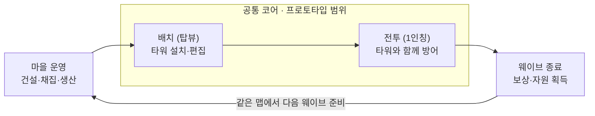

# 3D 타워 디펜스 — 게임 기획서

> 이 파일은 온라인 기획서(비공개)의 사본입니다. **원본은 온라인 문서**이며, 수정은 그쪽에서 하고 이 파일은 동기화로만 갱신합니다.
>
> 마지막 동기화: 2026-11-28

## 1. 개요

탑뷰로 방어선을 설계하고, 1인칭으로 직접 전장에 뛰어들어 타워와 함께 싸우는 하이브리드 타워 디펜스. 현재 목표는 핵심 재미를 검증할 프로토타입이다.

| 항목 | 내용 |
| --- | --- |
| 장르 | 타워 디펜스 + 1인칭 액션 |
| 엔진 | Unity 6.4 (6000.4.4f1), URP |
| 입력 | Input System |
| 플랫폼 | PC |
| 현재 단계 | 프로토타입 |
| 저장소 | [3D-Tower-Defense-Demo](https://github.com/Chosangyeol/3D-Tower-Defense-Demo) |

기존 타워 디펜스는 타워를 배치한 뒤 지켜보는 장르다. 이 게임은 배치가 끝나면 플레이어가 전장에 들어가 직접 전투에 참여하는 것이 차별점이다.

## 2. 게임 루프

게임 루프는 A안(마을 = 전장)으로 확정했다. 한 맵 안에서 마을 건설, 자원 채집·생산, 타워 배치, 1인칭 전투가 모두 일어난다. 프로토타입은 공통 코어(배치 → 전투)부터 만들고, 건설·자원 시스템은 그 위에 얹는다.

마을과 전장이 같은 맵이므로, 한 웨이브가 끝나면 같은 맵에서 건설·채집을 하고 다음 웨이브를 준비한다. 점선 안의 두 단계가 프로토타입 범위다.

| | A안: 건설 + 디펜스 동시 | B안: 마을·전투 분리 (스테이지) |
| --- | --- | --- |
| 구조 | 한 맵 안에 마을과 방어선이 공존. 웨이브 사이에 건설·배치 | 마을 → 스테이지 선택 → 배치 → 전투 → 보상 → 마을 |
| 마을의 역할 | 지켜야 할 대상이자 자원 생산원 | 영구 성장 허브 (업그레이드·강화) |
| 몰입감 | 높음: "내 마을을 지킨다" | 보통: 마을이 메뉴처럼 느껴질 위험 |
| 구현 범위 | 큼: 자원·건설·경제 시스템 추가 | 작음: 시스템이 분리됨 |
| 밸런싱 | 어려움: 건설·방어·전투가 얽힘 | 쉬움: 스테이지 단위 조정 |
| 콘텐츠 확장 | 맵 하나에 깊이를 추가 | 스테이지 추가 |

결정: A안. 몰입감과 "내 마을을 지킨다"는 동기를 택하고, 구현 범위가 커지는 위험은 자원 시스템을 단순화해 관리한다(5장). 위 비교표는 결정 근거로 남겨둔다.

결정: 배치 ↔ 전투는 웨이브마다 반복한다. 준비 시간이 지나면 다음 웨이브가 자동으로 시작되고, 기다리지 않고 바로 시작할 수도 있다. 첫 웨이브의 준비 시간은 마을·타워 배치 같은 기반 작업을 고려해 넉넉하게 둔다. 시점은 플레이어가 직접 전환하며, 전투 중에도 타워를 설치·제거할 수 있다.

결정: 스테이지 구분 없이 한 판을 30웨이브로 진행한다. 10웨이브마다 보스가 나오고, 마지막 최종 보스를 처치하면 클리어다. 클리어 후에는 플레이어가 제약을 골라 처음부터 다시 도전한다. 웨이브 구성은 직접 작성하고, 강도는 웨이브 배율과 제약으로 조절한다.

결정: 증강은 무작위 후보 3개 중 1개를 고른다. 등급은 일반·상위 두 가지이며 나올 때마다 무작위로 정하고, 후보 3개는 모두 같은 등급이다. 다시 뽑기는 한 판에 2번이며, 같은 등급에서 지금 나온 증강을 빼고 뽑는다. 새 후보 3개를 채울 수 없으면 다시 뽑을 수 없다. 증강마다 최대 중첩 횟수가 있으며, 가득 찬 증강은 후보에서 빠진다. 고르는 동안에는 게임이 멈추고, 고른 뒤에는 멈추기 전 상태에서 이어진다.

미정: 영구 성장, 증강의 최종 획득 방식(지금은 방식을 데이터로 넣고 빼며 시험한다).

## 3. 배치 단계 (3D 탑뷰)

플레이어는 맵을 내려다보며 자원 안에서 타워를 설치·이동·판매하고, 준비가 끝나면 전투를 시작한다.

- **카메라**: 탑뷰/쿼터뷰, 이동(WASD·화면 가장자리), 휠 줌, 회전
- **설치**: 하단 목록 버튼이나 숫자 키(1~9)로 설치 모드에 들어가 고스트 미리보기(설치 가능/불가 색상)를 보고 클릭으로 확정. 설치하면 설치 모드가 풀리고 Shift를 누른 채 설치하면 유지된다. 우클릭, ESC, 같은 버튼으로 취소한다. 타워 외의 건물도 같은 방식을 쓴다. 적 경로 칸에는 설치 불가
- **편집**: 설치한 타워를 클릭해 선택하면 정보와 제거 버튼이 나온다. 타워 이동은 아직 없다. 환급은 준비 시간 전액, 웨이브 진행 중 50%
- **정보 표시**: 타워 사거리 원, 적 이동 경로
- **전투 시작**: 단축키로 다음 웨이브를 바로 시작. 시점 전환은 별도 단축키

미정 항목

- 그리드 배치 vs 자유 배치 (프로토타입은 그리드로 가정)

## 4. 전투 단계 (1인칭)

플레이어는 1인칭으로 전장을 이동하며 직접 적을 공격하고, 타워는 사거리 안의 적을 자동으로 공격한다. 기지(코어) 체력이 0이 되면 패배한다.

- **플레이어**: 이동, 점프, 시점 조작, 마법 공격 (프로토타입은 1개: 단일 대상 투사체, 마나 소모·회복)
- **타워**: 자동 타겟팅(가장 앞선 적 우선), 타워별 공격 방식
- **적**: 고정 경로를 따라 이동하고, 기지 앞에 도착하면 겹쳐 서서 기지가 무너질 때까지 공격
- **승리**: 30웨이브의 최종 보스까지 처치. 클리어하면 제약을 골라 처음부터 다시 도전
- **패배**: 기지 체력 0

미정 항목

- 전투 중 타워 수리 가능 여부
- 플레이어 사망 시 처리 (부활 대기 / 즉시 패배)
- 적이 플레이어를 공격하는지 여부

## 5. 마을·자원 시스템

마을은 전장 안에 있고, 지켜야 할 대상이자 자원 생산원이다. 플레이어는 야생의 자원을 직접 채집하다가, 생산 건물로 자동화하고, 그 자원으로 타워와 건물을 짓는다. 자원·채집·연구는 프로토타입 완료 후 추가한다. 생산 건물 자동화와 마을 건설은 아직 범위 밖이다.

### 자원 흐름

1. **채집** (1인칭): 맵의 자원 노드에서 E를 길게 눌러 직접 채집. 노드는 고갈되면 시간이 지나 재생
2. **자동화** (탑뷰): 자원 노드 위에 생산 건물을 배치하면 일정 주기로 자원 생산
3. **저장**: 생산된 자원은 공용 창고로 바로 들어감 (운송·컨베이어 없음)
4. **소비**: 타워 설치·업그레이드, 마을 건물 건설, 플레이어 강화

자원은 시작 자원, 적 처치 보상, 웨이브 완료 보상, 1인칭 채집으로 얻는다. 연구는 배치 모드의 연구 화면에서 자원을 써서 하며, 환급되지 않는다. 구성은 6장의 연구를 따른다.

### 범위를 줄이는 원칙

- 자원은 3종만 둔다: 목재, 광석, 마력 결정(희귀)
- 운송 시스템은 넣지 않는다. 생산물은 공용 창고로 직행한다
- 희귀 자원은 자동화할 수 없게 해서, 1인칭으로 직접 나갈 이유를 남긴다. 마력 결정은 채집으로만 얻고 연구에만 쓴다
- 적은 생산 건물도 공격한다. 경제와 방어를 연결하기 위해서다

### 강화 대상 (초안)

| 분류 | 강화 내용 |
| --- | --- |
| 타워 업그레이드 | 공격력, 사거리, 공격 속도, 특수 효과 해금 |
| 플레이어 강화 | 체력, 이동 속도, 무기, 스킬, 채집 속도 |
| 마을 건물 | 생산 건물 레벨, 창고 용량, 기지 체력 |

미정 항목

- 생산 건물 종류와 생산 주기
- 마을 건물이 파괴되면 어떻게 되는지 (수리 / 재건설)
- 한 판이 끝나도 유지되는 영구 성장이 있는지

## 6. 콘텐츠 초안

프로토타입은 타워 3종, 적 4종으로 시작한다. 수치는 플레이 테스트 후 정한다.

### 타워

| 이름 | 역할 | 공격 방식 |
| --- | --- | --- |
| 기본 포탑 | 단일 대상 지속 피해 | 대상을 따라가는 투사체 연사 |
| 대포 | 범위 피해 | 쏜 순간의 위치로 느린 포탄 낙하, 착탄 폭발. 빠른 적은 먼 거리에서 피함 |
| 감속 탑 | 적 이동 속도 감소 | 일정 간격의 파동으로 범위 안의 적을 잠시 감속. 피해 없음 |

수치는 모두 시험용이다.

| 이름 | 비용 (목재/광석) | 사거리 | 피해 | 공격 간격 | 특수 |
| --- | --- | --- | --- | --- | --- |
| 기본 포탑 | 30 / 10 | 6 | 10 | 0.5초 | 없음 |
| 대포 | 30 / 40 | 7 | 30 | 2초 | 폭발 반경 2, 포탄 속도 10 |
| 감속 탑 | 40 / 20 | 4 | 없음 | 3초 | 50% 감속 1.5초 |

결정: 타워 증강과 연구는 모든 타워에 적용되는 것과 특정 타워 전용으로 나눈다. 감속 탑은 기본 상태에서 공격 간격이 감속 시간보다 길어 빈틈이 생긴다.

### 적

| 이름 | 특징 | 대응 |
| --- | --- | --- |
| 일반 | 기본 체력·속도 | 모든 타워 |
| 빠른 적 | 낮은 체력, 빠른 속도 | 감속 탑, 플레이어 |
| 탱커 | 높은 체력, 느린 속도 | 집중 화력 |
| 비행 | 지형 무시 | 일부 타워, 플레이어 |

### 보스

보스는 웨이브 데이터로 지정한다. 능력은 데이터로 만들어 계속 추가할 수 있고, 일반 적에게도 붙일 수 있다.

| 보스 | 능력 |
| --- | --- |
| 소환 군주 (10웨이브) | 부하 소환, 체력 50% 이하에서 가속 |
| 파쇄 거인 (20웨이브) | 주변 타워 정지, 체력 40% 이하에서 가속과 일시 보호막 |

30웨이브의 최종 보스는 파쇄 거인의 강화판이며, 부하 소환 능력이 더해진다.

### 증강

획득 방식은 하나씩 데이터로 만들고, 진행 데이터의 목록에 넣고 빼서 켜고 끈다. 수치는 모두 시험용이다.

| 획득 방식 | 지금 설정 | 상태 |
| --- | --- | --- |
| 정해진 웨이브 | 5·15·25웨이브를 막으면 제공. 일반 80% · 상위 20% | 사용 중 |
| 보스 처치 | 처치 즉시 제공 (마지막 웨이브 제외). 일반 30% · 상위 70% | 사용 중 |
| 제단 구매 | 맵의 제단에서 E 길게. 마력 결정 3, 살 때마다 +2. 일반 80% · 상위 20%. 켜면 마력 결정의 사용처가 연구 외에 하나 늘어난다 | 구현됨, 꺼 둠 |
| 1인칭 도전 | 정예 몬스터를 처치하고 보상 | 미구현 |

| 등급 | 증강 | 효과 | 최대 중첩 |
| --- | --- | --- | --- |
| 일반 | 날카로운 탄환 | 모든 타워 공격력 +15% | 3 |
| 일반 | 망원 조준기 | 모든 타워 사거리 +1 | 3 |
| 일반 | 마력 순환 | 마나 회복 +30% | 3 |
| 일반 | 가벼운 발걸음 | 이동 속도 +15% | 2 |
| 일반 | 전리품 수거 | 처치 보상 +20% | 3 |
| 일반 | 숙련된 채집 | 채집량 +50% | 2 |
| 상위 | 다연장 포탑 | 기본 포탑 전용: 적 3마리를 동시에 공격, 발당 피해 −30% | 1 |
| 상위 | 관통 마법 | 마법이 적을 3마리까지 관통 | 1 |
| 상위 | 서리 탄환 | 기본 포탑 전용: 맞은 적이 2초간 30% 느려짐 | 1 |
| 상위 | 저격 포탑 | 기본 포탑 전용: 사거리 +3, 공격력 +40%, 발사 간격 +30% | 1 |
| 상위 | 대마법사 | 마법 피해 +80%, 마나 소모 +30% | 1 |
| 상위 | 대량 생산 | 모든 타워 설치 비용 −30% | 1 |
| 상위 | 폭발 마법 | 마법이 적이나 지면·타워에 맞으면 반경 2 안의 적에게 50% 피해 (직접 맞은 적 제외) | 1 |
| 상위 | 기지 보수 | 웨이브를 막을 때마다 기지 체력 10 회복 | 1 |

### 연구

연구는 스킬트리처럼 앞 단계를 마치면 다음 단계가 열린다. 항목, 수치, 특수 능력은 추후 확정하며 아래 내용은 시험용이다. 데이터에서 언제든 바꾸고 추가할 수 있다.

- 타워·건물·플레이어 3개 탭으로 나눈다
- 택 1: 같은 갈래의 후보 중 하나만 고르며, 그 판 동안 바꿀 수 없다
- 처음에는 기본 포탑만 설치하고 연구할 수 있다. 다른 타워는 건물 탭에서 해금하면 설치와 전용 연구가 함께 열린다
- 비용을 내면 바로 완료되고, 판마다 초기화된다
- 건물 탭은 해금과 강화만 담당한다. 맵에 짓는 건물은 아직 범위 밖이다

예정: 연구는 연구소 건물을 지어야 할 수 있게 바꾼다. 아직 구현하지 않았으며 비용, 개수, 제거했을 때의 처리는 미정이다.

타워 탭. 비용(목재/광석/마력 결정)은 1단계 40/20/1, 2단계 60/40/2, 특수 60/60/4다.

| 갈래 | 1단계 | 2단계 | 특수 (택 1) |
| --- | --- | --- | --- |
| 공통 (모든 타워) | 설치 비용 −10% | 공격력 +10% | 없음 |
| 기본 포탑 | 공격력 +25% · 사거리 +1.5 | 발사 간격 −20% | 다중 발사(대상 +1, 공격력 −20%) · 서리 탄(25% 감속 1초) · 저격(사거리 +2, 공격력 +60%, 간격 +40%) |
| 대포 | 공격력 +25% · 포탄 속도 +50% | 폭발 반경 +0.5 | 충격탄(40% 감속 1초) · 쌍포(대상 +1, 공격력 −25%) · 거대 포탄(반경 +1.5, 간격 +35%) |
| 감속 탑 | 감속 시간 +0.4초 · 사거리 +1 | 감속 +10%p | 냉기 피해(파동 피해 8) · 취약(감속 중 받는 모든 피해 +20%) · 혹한(감속 +20%p, 간격 +20%) |

건물 탭.

| 갈래 | 연구와 효과 | 비용 | 선행 |
| --- | --- | --- | --- |
| 타워 해금 | 대포 해금 | 60/60/2 | 없음 |
| 타워 해금 | 감속 탑 해금 | 60/40/2 | 없음 |
| 채집 | 벌목 도구: 목재 채집량 +2 | 40/20/1 | 없음 |
| 채집 | 채광 도구: 광석 채집량 +2 | 40/20/1 | 없음 |
| 채집 | 숙련 채집: 채집 시간 −25% | 60/40/2 | 벌목 도구, 채광 도구 |
| 기지 | 기지 정비: 웨이브 완료 시 기지 회복 +5 | 60/60/2 | 없음 |

플레이어 탭. 비용 기준은 타워 탭과 같다.

| 갈래 | 1단계 | 2단계 | 특수 (택 1) |
| --- | --- | --- | --- |
| 마력 | 최대 마나 +30 | 마나 회복 +30% | 없음 |
| 마법 | 피해 +25% | 시전 간격 −15% | 관통(+2) · 폭발(반경 1.5, 피해의 40%) · 속사(간격 −35%, 마나 소모 −30%, 피해 −25%) |
| 이동 | 이동 속도 +10% | 없음 | 없음 |

## 7. 프로토타입 범위와 로드맵

프로토타입의 목표는 "탑뷰 배치 후 1인칭으로 함께 싸우는 것이 재밌는가"를 확인하는 것이다. 맵 1개, 웨이브 30개, 타워 1~3종으로 한 판을 끝까지 플레이할 수 있으면 완료다.

### 프로토타입 체크리스트

- [ ] 탑뷰 ↔ 1인칭 카메라 전환
- [ ] 그리드 타워 배치 (고스트 미리보기, 사거리 표시)
- [ ] 적 경로 이동 및 웨이브 스폰
- [ ] 타워 자동 타겟팅·공격
- [ ] 1인칭 플레이어 이동·공격
- [ ] 기지 체력, 승패 판정, 최소 UI

### 로드맵

1. **프로토타입** (진행 중): 위 체크리스트, 회색 박스 아트
2. **수직 슬라이스**: 맵 1개 완성, 마을 건설, 자원 채집·자동화, 기본 아트·사운드
3. **콘텐츠 확장**: 타워·적·건물·맵 추가, 밸런싱, 세이브/로드

## 8. 결정 대기

아래 항목은 위에서부터 정할수록 이후 구현 방향에 미치는 영향이 크다.

- [ ] 게임 루프: A안 (확정, 마을 = 전장)
- [x] 배치 ↔ 전투 주기: 웨이브마다 (확정)
- [x] 적 경로: 고정 경로 (확정)
- [x] 플레이어 무기: 마법 (확정)
- [ ] 아트 스타일 (로우폴리 / 카툰 / 사실적)
- [ ] 싱글 전용 (확정, 멀티플레이 제외)
- [ ] 플랫폼: PC (확정)
